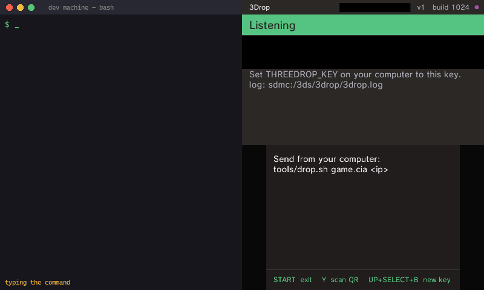
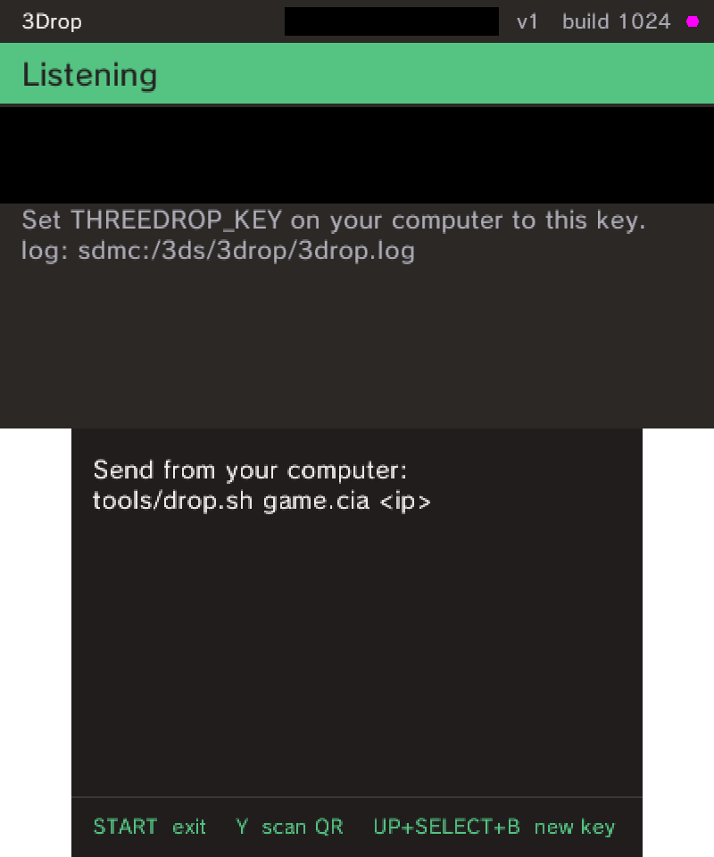

# 3Drop

[](https://github.com/MadeOfBees/3Drop/actions/workflows/check.yml) [](https://github.com/MadeOfBees/3Drop/releases/latest) [](LICENSE)

> Trying a new build on a 3DS usually means a slow download, a slow install, and then a wait for the HOME Menu before you can even open it. With 3Drop, you do it all from the terminal on your dev machine.

One command, and your new build is installed and running on the 3DS:

```sh
tools/drop.sh --run game.cia <ip>
```



3Drop is the homebrew app on the other end. Leave it open, and from your PC's terminal you can install and launch CIAs, sync LayeredFS files, and push and pull files on the SD card, all over Wi-Fi. Add [one line to your app](#back-to-3drop-when-your-app-exits). When it exits, you're back in 3Drop instead of the HOME Menu, ready for the next build.



Installs stream straight into AM, the console's own installer. On an Old 3DS over home Wi-Fi, a 528 MB CIA installs in 5.5–5.8 minutes (1.52–1.59 MB/s), unless AM slows the whole install down, which is [rare](docs/troubleshooting.md#known-limitations).

3dslink sends a 3dsx only after you press **Y** in the Homebrew Menu. FBI's Remote Install makes you confirm every request on the console. FBI took 3.7 times as long as 3Drop to install a 106 MB CIA.

Commands to the console are signed with HMAC-SHA512 under a key the console generates, and the key never crosses the wire. [Safety](docs/safety.md#safety) says how discovery and installs are checked, and gives the rest of the rules.

- The PC side is the scripts in `tools/`, run from a clone of this repo ([Quickstart](#quickstart)).
- The tools also handle self-update, seeds, batches, uninstall, screenshots and a `stats` report ([Everyday development](#everyday-development), [Device commands by task](docs/commands.md#device-commands-by-task)). File commands even reach inside a game's save data and its extdata, the extra data some games keep.
- Press **Y** on the idle screen, scan a QR code of CIA links, and confirm: 3Drop installs the CIAs with no PC involved ([Install from a QR code](#install-from-a-qr-code)).
- Close the lid, and Wi-Fi stays up while 3Drop is on screen. The notification LED shows 3Drop's status ([Screen and LED](docs/troubleshooting.md#screen-and-led)).

[Speed](#speed-compared-with-fbi-and-ftpd) · [Quickstart](#quickstart) · [QR install](#install-from-a-qr-code) · [Everyday development](#everyday-development) · [Documentation](#documentation)

## Speed compared with FBI and ftpd

We timed these on an Old 3DS over home Wi-Fi on 20, 21 and 23 November 2026, against FBI 2.6.1's Remote Install for installs and ftpd 3.2.1 for SD card files. The Old 3DS is the only one we had while building 3Drop, so that's what it's tuned for. We haven't tried a New 3DS yet.

| Task | 3Drop | FBI | Result |
|---|---|---|---|
| Install a new CIA, about 1.3 MB | 7.53 s | 11.7 s | 1.6x faster |
| Install a CIA update, about 1.3 MB | 2.45 s | 12.5 s | 5.1x faster |
| Install a new CIA, about 18 MB | 16.1 s (1.11 MB/s) | 50.4 s (0.36 MB/s) | 3.1x faster |
| Install a CIA update, about 18 MB | 12.7 s (1.41 MB/s) | 49.9 s (0.36 MB/s) | 3.9x faster |
| Install a new CIA, about 106 MB | 69.1 s (1.53 MB/s) | 256 s (0.41 MB/s) | 3.7x faster |
| Install a CIA update, about 106 MB | 69.0 s (1.53 MB/s) | 255 s (0.41 MB/s) | 3.7x faster |
| Install a homebrew game's CIA from its download link, 71 MB | 48.2 s (1.48 MB/s) | 350 s (0.20 MB/s) | 7.3x faster |

| Task | 3Drop | ftpd | Result |
|---|---|---|---|
| Download a file from the SD card, 1 KiB | 0.16 s | 0.50 s | 3.0x faster |
| Upload a file to the SD card, 1 KiB | 0.20 s | 0.41 s | 2.1x faster |
| Download a file from the SD card, 1 MiB | 1.50 s | 2.95 s | 2.0x faster |
| Upload a file to the SD card, 1 MiB | 1.48 s | 2.59 s | 1.7x faster |
| Download a file from the SD card, 4 MiB | 5.17 s | 10.3 s | 2.0x faster |
| Upload a file to the SD card, 4 MiB | 3.22 s | 8.81 s | 2.7x faster |
| Download a file from the SD card, 32 MiB | 39.4 s (0.85 MB/s) | 55.2 s (0.61 MB/s) | 1.4x faster |
| Upload a file to the SD card, 32 MiB | 23.9 s (1.40 MB/s) | 216 s (0.16 MB/s) | 9.1x faster |
| Download a file from the SD card, 100 MiB | 124 s (0.85 MB/s) | 167 s (0.63 MB/s) | 1.4x faster |
| Upload a file to the SD card, 100 MiB | 71.2 s (1.47 MB/s) | 219 s (0.48 MB/s) | 3.1x faster |
| Download a folder, 200 files | 32.0 s | 153 s | 4.8x faster |
| Upload a folder, 200 files | 63.3 s | 155 s | 2.4x faster |
| List a folder of 1,024 files | 108 s | 119 s | 1.1x faster |
| Read a file's size | 0.16 s | 0.14 s | 3Drop slower |
| Delete a file | 0.16 s | 0.17 s | 7% less time |
| Rename a file | 0.18 s | 0.24 s | 1.3x faster |
| Make a folder | 4.53 s | 4.52 s | 3Drop slower |
| Remove a folder | 0.17 s | 0.18 s | 9% less time |
| Finish an interrupted download, 100 MiB | 134 s | 240 s | 1.8x faster |
| Finish an interrupted upload, 100 MiB | 98.0 s | 182 s | 1.9x faster |

3Drop was faster in 25 of 27 tasks. Each time is the median of five tries (three for the longest ones), and a failed try counts as the slowest. Big transfers show their speed in parentheses. The 71 MB row installs a real homebrew game's CIA from the link its project publishes: for 3Drop the PC downloaded it and then sent it, and FBI downloaded it on the console. FBI makes you confirm every install on the console, so its times include that A press, which our script sends after a fixed 1.5 s wait. 3Drop went first in every pair. Each run began with an unscored trial attempt for ftpd and one for FBI, but none for 3Drop. The 23 November run timed only the two tasks where 3Drop had come out slower in the first three runs (reading a file's size and making a folder), and those two rows come from it. The full method is in [Compared with FBI and ftpd](docs/benchmarking.md#compared-with-fbi-and-ftpd).

## Quickstart

### What you need

- A 3DS running Luma3DS custom firmware v12.0 or later, with FBI or Universal Updater to install 3Drop. We've only used 3Drop on an Old 3DS so far, with Luma v12.0.1 and then v13.3.3.
- A PC with a clone of this repo and the commands below. The PC runs macOS 13 or later, Linux, WSL 2 on Windows, or Git Bash on Windows. The tools are bash scripts, so on Windows run them in Git Bash (part of Git for Windows) or WSL, not PowerShell or cmd. macOS, most Linux, WSL's Ubuntu and Git for Windows come with all of these commands:
  - `bash` and `openssl`, for every tool. The tools need `enc` with `-pbkdf2` and `-iter`, which OpenSSL 1.1.1 or later and LibreSSL have.
  - `curl`, for seeds.
  - `perl`, for `discover`'s name lookup and probe, for the GUI bridge, and for benchmarking.
  - `gzip`, only under `THREEDROP_COMPRESSION=auto`. Without gzip, everything goes uncompressed.
- If you only install from QR codes, you don't need the PC: do steps 1 and 2, then go to [Install from a QR code](#install-from-a-qr-code).

[Host setup](docs/configuration.md#host-setup) says how each kind of PC is tested, gives its notes, and says what `nc` and macOS's own tools are used for.

### 1. Install 3Drop on the 3DS

Scan this code in FBI's Remote Install to install the newest `3drop.cia`:


`https://github.com/MadeOfBees/3Drop/releases/latest/download/3drop.cia`

Each [release](https://github.com/MadeOfBees/3Drop/releases) page has its own code for that release, `3drop-qr.png`. Or download `3drop.cia` from a release, copy it to the SD card and install it with FBI. To install and update it through [Universal Updater](https://github.com/Universal-Team/Universal-Updater) instead, add the store once by its URL or QR code:


`https://github.com/MadeOfBees/3Drop/releases/latest/download/3drop.unistore`

A console with Luma but neither installer can get one through the Homebrew Menu, which [Luma3DS's releases](https://github.com/LumaTeam/Luma3DS/releases) bundle. Copy [Universal Updater](https://universal-team.net/projects/universal-updater)'s `.3dsx` to the SD card's `/3ds` folder (with a computer or a card reader), run it from the Homebrew Menu, then come back to this step.

[Updating 3Drop and the tools](docs/configuration.md#updating-3drop-and-the-tools) says how updates reach 3Drop, and why the key survives them.

**Checking a download.** Every release page lists `SHA256SUMS`, the SHA-256 of each other file it carries. To check `3drop.cia`, put it and `SHA256SUMS` in one folder and run the line for your PC. It says `3drop.cia: OK` (PowerShell says `True`) when the file is the one the release lists, and `FAILED` (`False`) when it is damaged or not that file. This shows a bad download, not who made the file.

```sh
grep ' 3drop.cia$' SHA256SUMS | sha256sum -c       # Linux, WSL and Git Bash
grep ' 3drop.cia$' SHA256SUMS | shasum -a 256 -c   # macOS
```

```powershell
(Get-FileHash 3drop.cia).Hash -eq ((Get-Content SHA256SUMS | Select-String ' 3drop\.cia$').Line -split ' ')[0]   # Windows PowerShell
```

### 2. Launch 3Drop

On first run, 3Drop generates a random key of the form `xxxx-xxxx-xxxx` (about 60 bits) and saves it to `sdmc:/3ds/3drop/key.txt`. It shows the key on screen, with the console's IP and port (1337). Leave 3Drop open, because the tools reach the console through it.

The top screen's top-right line also names 3Drop's release and build number, as in `192.168.1.20:1337   v1   build 1024`.

The console needs a Wi-Fi network that gives it a real IPv4 address. While the screen shows `unknown:1337`, it has none, and that is not an address to copy. The PC must reach the console on that same network. A guest network that keeps its devices apart stops every command.

### 3. Clone the tools

Clone the release that 3Drop's top screen names. In the command below, replace `<tag>` with that name (`v1` in the example above). Every release is on the [releases](https://github.com/MadeOfBees/3Drop/releases) page. Run every command in this README from the clone's root.

- **WSL:** clone in the distribution's own home (`~/3Drop`), not `/mnt/c`, and install the commands above there. The tools run as Linux programs in the distribution.

```sh
git clone --branch <tag> https://github.com/MadeOfBees/3Drop.git
cd 3Drop
```

Every tool's `--version` prints your clone's release, which should match 3Drop's top screen. With the example above, `tools/device.sh --version` says `v1`. It says `v1-dirty` once you edit a tracked file, and a copy without `.git` says `unknown`. Keep the clone on the release 3Drop runs. At every exchange, the tools check that they speak the console's protocol (see [Updating 3Drop and the tools](docs/configuration.md#updating-3drop-and-the-tools)).

### 4. Pair: put the key on your PC

Copy the key from the screen, or off the SD card, into `THREEDROP_KEY`. Either put the line `THREEDROP_KEY=<the-key>` in `.env` at the repo root (gitignored), or export it.

> **The key is a secret, and it runs code.** Anyone who has it can install apps and run code on your console. Keep the key, `.env` and your checkout to yourself, and never paste the key into a commit, a log or an issue. Requests are signed but not encrypted, so use 3Drop only on a network you trust. The full rules are under [Safety](docs/safety.md#safety).

[Configuration and pairing](docs/configuration.md#configuration-and-pairing) covers a key of your own, a new key, a missing one, and how `.env` meets exported variables.

### 5. Check the link

First ask the console for its state. This changes nothing on it:

```sh
tools/device.sh stats <ip> self
```

`<ip>` is the address on the console's top screen, typed as the screen shows it, port and all: `192.168.1.20:1337`. Reserve it in your router so it never moves (see [The console's address](docs/configuration.md#the-consoles-address)).

A good answer is one line that holds `stats ok ok 00000000`, then the console's state: its build (`ver=`), `state=ready`, the SD card's free space, the battery and more.

If the console doesn't answer, the tool asks three times. It says what each try met, as `no reply from <ip>:<port> (try 1 of 3)` or `timed out: … (try 1 of 3)`, then what to check. Then run `tools/device.sh discover`. For each address, and each way it looks for the console, it says why there was no answer. Then it points you to the console's screen.

### 6. Send your first CIA

With 3Drop on screen:

```sh
tools/drop.sh game.cia <ip>
```

`game.cia` is any homebrew application's CIA: your own build, or one from another project's release. In Git Bash, write a Windows path with forward slashes (`C:/Users/you/Downloads/game.cia`) or put it in quotes, because bash drops backslashes that aren't quoted.

Before it sends anything, `drop.sh` asks the console what is installed, and it sends nothing if the console doesn't answer. For an application, it also asks Nintendo's seed server for the title's seed (see [Seeds](#seeds)), and `--no-seed` skips that. With no internet, it says the seed was not fetched. That matters only for a seed-encrypted title.

The top screen shows the transfer's progress, rate and time left. A committed install prints its reply on stdout, and `drop.sh` exits 0:

```
put committed ok 00000000 <title-id> <version> new
```

The last word is the route the CIA went by: `new`, `update` or `self` (see [New, update or self](#new-update-or-self)). With the lid closed, the LED turns steady green once the install has committed. If the install is refused, the reason goes to stderr, starting with the tool's name (`drop: …`). Where the console's one-word reason needs explaining, a sentence follows. See [What a message means](docs/troubleshooting.md#what-a-message-means), [Exit status](docs/troubleshooting.md#exit-status) and [Recovery](docs/troubleshooting.md#recovery).

## Install from a QR code

Press **Y** on the idle screen and point the outer camera at a QR code. The code holds one CIA link, or several, one per line, up to sixteen. A link written without a scheme is taken as `https://`. Write `http://` for plain http, which the confirm screen marks and warns about. While a QR screen waits, 3Drop still answers `stats`, which says `state=qr`, and `screenshot`. Every other command is refused as `busy`. During a download or install it answers nothing. **B** gives up and goes back.

Each link must download the CIA itself, from a server that says the file's size (`Content-Length`). A server that does not, such as one that only sends its reply in chunks, is refused (`no-length`).

**The confirm screen** lists every link by its number, its site and then its path. It reads the link as libcurl does, so a `name@` or a long prefix before the host is never shown as the site. On github.com, the path shows the owner, the repository and the file.

- A path of up to 120 characters is shown whole. A longer one shows its first 90 characters, `...`, and its last 27.
- The part after `?` is never shown. A link that has one ends its path with `?...`. Two links that differ only in that part, or in the hidden middle of a long path, look alike.
- A plain `http://` link is marked, and the bottom screen says it is not encrypted. Someone on the network can replace the file.

Nothing is fetched until you press **A**. **A** installs every link, including links you have not scrolled to. **B** cancels.

A QR install is checked the same way as a CIA from your computer, and 3Drop picks `new`, `update` or `self` itself. A title already installed is updated when the CIA's version is newer. The same version or an older one is refused (`not-newer`), and the screen says that version, or a newer one, is already installed. A newer 3Drop CIA updates 3Drop and relaunches it. Links after it are not installed, and the log counts them. A link that fails stops the rest of the code, and the log counts those too.

**Certificates.** Every https download is checked against the certificate list at `sdmc:/config/ssl/cacert.pem`, which Universal Updater uses too. A link to an IPv4 address, such as your own machine's, passes with an otherwise trusted certificate that lists that address among its names (`subjectAltName=IP:…`, as mkcert makes it). The console keeps its own clock, which is often set wrong, so certificate dates are not checked: an expired certificate still passes. A failed check names the link and the cause. Then **A** fetches a fresh list and tries again, **Y** skips the check for that one link, and **B** cancels. A link whose check you skip is as open as plain http, so someone on the network can replace the file.

- **Canceling:** **B** or START stops a download. While the data already downloaded drains into the install, the writer stops after the write it is in. The import is canceled and nothing is committed. Once the screen says **Committing**, you can no longer cancel, so do not power off. After a canceled download you can scan again.
- **Seeds:** a QR install imports none, so a seed-encrypted title goes through `drop.sh`, or FBI with its seed file (see [Seeds](#seeds)).

[QR downloads and certificates](docs/safety.md#qr-downloads-and-certificates) covers how the certificate list is first fetched and refreshed, redirects, the name lookup, and the rest of the confirm screen's rules.

## Everyday development

### The commands

| command | what it does |
|---|---|
| `tools/drop.sh` | installs a CIA, and launches it with `--run` |
| `tools/dropBatch.sh` | installs several CIAs |
| `tools/sync.sh` | sends a title's changed LayeredFS files, then launches it |
| `tools/device.sh` | everything else: titles, seeds, files, saves, screenshots, `stats` and `discover` |
| `tools/bridge.sh` | serves the SD card to FileZilla, WinSCP or Cyberduck |

Each one prints its help with `--help`, and its release with `--version`. The other scripts in `tools/` build, test and publish 3Drop itself (see [Building](docs/building.md#building)), or are libraries the five use.

The loop, once 3Drop is paired:

```sh
tools/drop.sh --run game.cia <ip>               # install a new build and launch it
tools/sync.sh <title-id> <stub-dir> <ip>        # LayeredFS: send the changed files, then launch
tools/drop.sh --self 3drop.cia <ip>             # update 3Drop itself
```

Each command talks to 3Drop. Once `--run` or `sync.sh` has launched your app, the next command needs 3Drop back on screen. [Back to 3Drop when your app exits](#back-to-3drop-when-your-app-exits) does that without touching the console.

### From your own build

To make the install your build's last step, give your project's Makefile (GNU make) a rule that hands the CIA it builds to `drop.sh`. The rule also names the path of your 3Drop clone and your console's address:

```make
THREEDROP ?= $(HOME)/3Drop
CONSOLE_IP ?= 192.168.1.20
.PHONY: drop
drop: $(TARGET).cia ; "$(THREEDROP)/tools/drop.sh" --run "$<" "$(CONSOLE_IP)"
```

`make drop` then builds the CIA, installs it and launches it, and an editor's build task can run `make drop` too. The tools read the key from the `.env` in their own clone, whatever folder you run them from.

### Back to 3Drop when your app exits

`--run` launches your app in place of 3Drop. When the app exits, the console goes to the HOME Menu, where 3Drop has to be opened by hand before the next drop. During development your app can go straight back to 3Drop instead, so the next `drop.sh` needs no hands on the console. Before the app exits, set libctru's chainloader to 3Drop's title:

```c
aptSetChainloader(0x0004000003D37200ULL, MEDIATYPE_SD); // 3Drop, installed on the SD card
```

- **Where:** once your app leaves its main loop, before `main` returns. libctru's `aptExit`, which runs as the app exits, then launches 3Drop in place of the HOME Menu.
- **Exit from your app itself,** not by closing it from HOME. An app closed from HOME goes to the HOME Menu, chainloader or not.
- **Sleep:** if your app turns sleep off (`aptSetSleepAllowed(false)`), leave it off for the jump. With the lid closed, APT would sleep first.
- **From a 3dsx:** the return works from installed titles (CIAs), but not from a 3dsx. A 3dsx that exits starts the Homebrew Menu, not 3Drop (see [Known limitations](docs/troubleshooting.md#known-limitations)).

[3Drop's title ID](docs/building.md#3drops-title-id) says where the title ID comes from, and names the Testing Tool that does the same.

### Installing with drop.sh

```sh
tools/drop.sh [--new|--update|--self] [--run] [--no-bump] [--no-seed] <file.cia> <ip> [port]
```

For several CIAs at once, see [Batch installs](#batch-installs). For a title's changed LayeredFS files, see [LayeredFS sync](#layeredfs-sync).

- **`--run`** launches the application once it is installed. For a patch or DLC, it launches its game. A title whose LayeredFS folder holds a `romfs` folder is installed but not launched (see [LayeredFS sync](#layeredfs-sync)).
- **`--self`** updates 3Drop itself, which then relaunches into the new build. The CIA must be a newer title version than the installed one, and `tools/deploy.sh` builds it that way (see [Building](docs/building.md#building)).
- **Seeds:** `drop.sh` asks Nintendo's server for an application's seed as its install begins. Once the application is installed, the console imports the seed, before any launch (see [Seeds](#seeds)). A title with no seed needs nothing, a failed import only warns, and `--no-seed` skips the step.

### New, update or self

With no intent flag (`--new`, `--update` or `--self`), `drop.sh` asks the console what is installed:

- **Not installed:** it sends the CIA as `new`.
- **An older version installed:** it sends it as an in-place `update`.
- **The same or a newer version installed:** it sends a temporary copy whose title metadata (TMD) version is the installed one + 1, as an `update`. `--no-bump` refuses instead, and so does a patch or DLC, because a forged version would shadow the real release.
- **Version 65535 installed:** nothing newer exists, so it refuses. Uninstall the title with `device.sh uninstall` (an application's save data goes with it), then send it with `--new`.
- **3Drop's own title** (`0004000003d37200`) goes as `self`.
- **After an install whose answer never came** (exit 4 or 124, or a kill): run the same command again, with the same CIA and key, to the same address and port. If the lost run left its note, and the version it sent is installed, `drop.sh` says the install is done and sends nothing. The note is kept only for a CIA `drop.sh` routed itself, when it can be, in `~/.cache/3drop` (`$XDG_CACHE_HOME/3drop` when that is set). So check what is installed first in the cases with no note: on another PC, with that cache gone, after a command with an intent flag, or for 3Drop's own CIA. There, sending an application's CIA again bumps it one version past the installed one.

An intent flag names the route instead. 3Drop's own title goes as `--self`, and nothing else does. Either mistake is refused as `route` (see [Known limitations](docs/troubleshooting.md#known-limitations)).

### Batch installs

```sh
tools/dropBatch.sh [--new|--update] [--run N] <ip> a.cia b.cia …
```

`dropBatch.sh` sends each CIA as its own install. Applications go first, then updates, then DLC, each group in the order given. `--new` or `--update` goes to every item's `drop.sh`.

- A title already installed at the same or a higher version is skipped, so re-running an interrupted batch sends only what is missing.
- A failed item does not stop the rest. The batch stops early only when a benchmark run on this PC holds the console, or when an item got no answer and the console then answers no `stats` either. The exit status is the first failed item's.
- `--run N` always sends item N, where N counts the CIAs as given. The one exception is a patch or DLC already installed at its version or newer. Item N is launched (for a patch or DLC, its game) only if every item succeeded.

### LayeredFS sync

```sh
tools/sync.sh [--force-full-sync] [--game] <title-id> <stub-dir> <ip> [port]
```

LayeredFS is Luma3DS's way of running a title with files from `sdmc:/luma/titles/<title-id>/` in place of its own. The stub, `<stub-dir>`, is the local folder whose contents belong there. `sync.sh` puts it there the way a folder `put --overwrite` does. It sends each file whose SHA-256 changed since the last sync, and each file the card no longer holds as that sync left it. `--force-full-sync` sends everything. Then it launches the title, if anything was sent and nothing was skipped.

- **It never deletes.** A file you remove from the stub stays on the card, where the game still reads it, until you delete it there: `tools/device.sh delete <ip> /luma/titles/<title-id>/<path>`.
- It needs Luma3DS's "Enable game patching".
- **A `romfs` folder crashes the console in Luma's loader unless the title is a game built with Nintendo's SDK.** `sync.sh` sends a stub that has one only with `--game`, which says the title is such a game. For your own app, leave the folder out (see [`layeredfs`](docs/troubleshooting.md#what-a-message-means)).
- The console takes writes under `/luma/titles` and `/luma/plugins` only into an application's directory, never 3Drop's own or a system title's.
- A sync cut short leaves the stub part new, part old: see [Known limitations](docs/troubleshooting.md#known-limitations).

### Seeds

Some eShop games are seed-encrypted. Installed without their seed, they black-screen at launch. `drop.sh` imports an application's seed after installing it, and `device.sh seed` does so for a title already installed. A QR install imports none (see [Install from a QR code](#install-from-a-qr-code)).

- The seed comes from Nintendo's server over https, checked only against Nintendo's own CA (`tools/nintendo-class2-ca-g3.pem`) for the server's name. Or it comes from a 16-byte file, the form FBI keeps in `sdmc:/fbi/seed/<title-id>.dat`. Either way the console adds it to its seed database. The tools ask the server as a US console, so a game sold only outside the US may get no seed that way. If such a game black-screens at launch, give it the 16-byte file with `tools/device.sh seed <ip> <title-id> <seed-file>`.
- The console never replaces a seed it holds, even a wrong one, which is why the tools take a seed from no server that CA does not vouch for.

## Documentation

**Using 3Drop:** [Quickstart](#quickstart) · [QR install](#install-from-a-qr-code) · [Everyday development](#everyday-development) · [Device commands by task](docs/commands.md#device-commands-by-task) · [GUI file clients](docs/gui-bridge.md#gui-file-clients) · [File-transfer reference](docs/file-transfer.md#file-transfer-reference) · [Configuration and pairing](docs/configuration.md#configuration-and-pairing) · [Host setup](docs/configuration.md#host-setup) · [Updating](docs/configuration.md#updating-3drop-and-the-tools) · [Safety](docs/safety.md#safety) · [What a message means](docs/troubleshooting.md#what-a-message-means) · [Troubleshooting and limitations](docs/troubleshooting.md#troubleshooting-and-limitations) · [Screen and LED](docs/troubleshooting.md#screen-and-led) · [Files and local state](docs/configuration.md#files-and-local-state)

**Working on 3Drop:** [Building](docs/building.md#building) · [Tests](docs/building.md#tests) · [Benchmarking](docs/benchmarking.md#benchmarking) · [Publishing releases](docs/building.md#publishing-releases) · [License](#license)

## Getting help

3Drop is a one-person project, so replies come as time allows.

- **Something went wrong:** [Troubleshooting and limitations](docs/troubleshooting.md#troubleshooting-and-limitations) says what each message means and how to recover. If it does not answer, open the bug report form from [New issue](https://github.com/MadeOfBees/3Drop/issues/new/choose). The same page has the feature request form, for an idea.
- **A security problem:** report it privately, never in an issue. [SECURITY.md](SECURITY.md) says how, through GitHub's [private vulnerability report](https://github.com/MadeOfBees/3Drop/security/advisories/new).
- Never paste your key, `.env` or `key.txt` into an issue. [CONTRIBUTING.md](CONTRIBUTING.md) covers changes.

## License

3Drop is free software under the GNU General Public License v3.0 or later. See [LICENSE](LICENSE).

Copyright (C) 2026 MadeOfBees, including the icon, the banner and its sound in `res/`.

Built with devkitPro's devkitARM, libctru, citro2d and citro3d, [Mbed TLS](https://github.com/Mbed-TLS/mbedtls) (used under GPL-2.0-or-later) and zlib. It also links [libcurl](https://curl.se/libcurl/) statically, under [the curl license](https://curl.se/docs/copyright.html), and builds in [quirc](https://github.com/dlbeer/quirc), the QR code decoder, vendored unmodified in `src/quirc/` under the ISC license. It carries Mozilla's list of certificate authorities, as curl.se publishes it (`res/cacert.pem`), under the Mozilla Public License 2.0.

Each release also attaches the libraries' sources, in two files. `3drop-library-sources.tar.gz` holds the exact sources of those libraries as the pinned build image holds them, with devkitPro's build recipes and patches. `3drop-library-sources.txt` lists their versions, licenses, SHA-256s and upstream links. quirc and 3Drop's own source are this repository at the release's tag.
